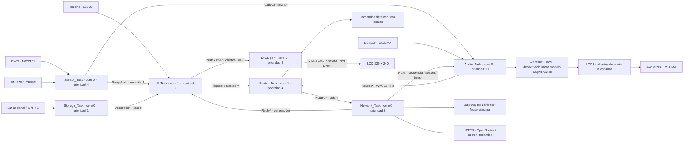

# Sagwa Edge 0.3.0-dev

Implementación modular para ESP32-S3/CoreS3, compilada con ESP-IDF 6.0.1. Es un proyecto de desarrollo independiente: **no sustituye el firmware 0.2.0 instalado**. Las pruebas físicas breves J/M midieron transferencias SPI, sensores y arranque con rollback obligatorio; todavía faltan aceptación visual, voz, WakeNet y estabilidad de la versión final. M midió 26,392–31,280 FPS, por lo que 30+ FPS estables sigue pendiente.

## Hardware y límites

CoreS3 tiene 16 MB de flash, 8 MB de PSRAM, ES7210 para los dos micrófonos, AW88298 para el altavoz, BMI270, LTR553 y AXP2101. El driver del BSP usa el controlador táctil compatible FT5x06 para FT6336U y reconoce las variantes ILI9342C/E. **No usa ES8388.** [Hardware oficial](https://docs.m5stack.com/en/core/CoreS3), [BSP oficial](https://github.com/espressif/esp-bsp/tree/master/bsp/m5stack_core_s3).

No hay motor háptico integrado ni sensor de temperatura ambiental integrado. La confirmación inmediata es auditiva y visual. El modo Entorno puede mostrar luz/proximidad locales; el clima y la temperatura requieren una fuente externa identificada.

## Tareas y propiedad

`UI_Task` es la única tarea de aplicación que modifica objetos LVGL. También hay una tarea interna del port LVGL: ambos usan `bsp_display_lock`, y el port libera la transferencia al terminar DMA. Los callbacks táctiles corren en ese mismo dominio protegido. Audio, HTTP y lectura de archivos no toman el mutex de display. No hay HTTP ni I2S dentro del renderizador.

Las colas no copian `std::string` por bytes: transfieren punteros con propiedad exclusiva. El receptor usa `unique_ptr`; al desbordar una cola se destruye el objeto. `Event` y `SensorSnapshot` son datos simples copiados por valor. Las FFT comparten tres bandas mediante un mutex corto; las métricas de sensores usan atomics y una cola de último valor. La generación de turno descarta resultados, audio y eventos antiguos.

| Tarea | Stack reservado | Periodo / bloqueo |
|---|---:|---|
| UI_Task | 8 KB | Candidato N: actualización cada 28 ms; espera de mutex ≤5 ms; rendimiento físico pendiente |
| Audio_Task | 16 KB | Bloques I2S de 20 ms; WakeNet según tamaño real del modelo |
| Sensor_Task | 4 KB | PWR/IMU cada 20 ms; entorno cada 100 ms; métricas cada segundo |
| Router_Task | 6 KB | Bloqueada en cola hasta una solicitud |
| Network_Task | 16 KB | HTTPS hasta 10 s por operación, límite de respuesta/turno; UI independiente |
| Storage_Task | 16 KB | Escaneo cada 2 s; 8 KB por descriptor, huella SHA-256 |
| Console_Task | 4 KB | Consola de desarrollo; sin eco de credenciales |
| Camera_Task | 8 KB | V4L2 solo por acción explícita; timeout de captura, preview local |
| Maintenance_Task | 8 KB | Ofertas firmadas/verificación de arranque; nunca en UI |

Los stacks de tareas y DMA de control permanecen en RAM interna. Buffers gráficos, captura y JSON grandes aprovechan PSRAM; se comprueba memoria disponible en las pruebas de aceptación. Watchdog de 10 s, sin bucles de espera activa en tareas de aplicación.

## Animación y diseño

`AnimationFSM` reemplaza el GIF como reloj de comportamiento. Respiración sinusoidal, parpadeo aleatorio de 2–7 segundos, pupilas con seguimiento amortiguado, orientación de orejas y cola como resorte amortiguado. Las transiciones usan smoothstep y filtros exponenciales; la amplitud de boca sigue el PCM realmente reproducido mediante FFT de 256 puntos. Los estados de escucha/habla prevalecen sobre las caricias y la oscuridad. Una IMU con más de 250 ms se descarta.

El rig en `graphics.cpp` usa doce piezas transparentes derivadas con ImageGen a partir de la referencia original de Sagwa: cuerpo, cabeza, orejas, ojos, pupilas, párpados, boca y cola. `assets/sagwa-rig` conserva el atlas, piezas, composición de QA y procedencia. Son arte nuevo; los originales de Muse y los clips de 0.2.0 quedan intactos. Las piezas sustituyen las primitivas del rig de referencia; todavía requieren comparación visual en pantalla y aceptación física.

Pantalla negra `#000000`, Inter 16 px comprimida con signos/acento españoles, texto blanco y emoji Noto estático de 28 px a la derecha. La mascota ocupa 136 px; el modo Trabajo la reduce a la esquina. Los widgets de diagnóstico/terminal aparecen solo en sus modos. Bordes izquierdo/derecho/superior abren menú/herramientas/preferencias; el borde izquierdo vuelve a la pantalla anterior mediante historial acotado. El texto se desplaza y se abre en lectura ampliada. Las listas tienen filas de 44 px y separaciones de 4 px.

Dos buffers completos RGB565 en PSRAM: `2 × 320 × 240 × 2 = 307,200` bytes. El BSP configura DMA y el tamaño máximo de transferencia para 240 líneas. [Port LVGL oficial](https://github.com/espressif/esp-bsp/tree/master/components/esp_lvgl_port). La SPI de 40 MHz necesita aproximadamente 30.7 ms para un frame completo; el motor actualiza regiones pequeñas cuando cambian. **30+ FPS es un objetivo de medición, no un resultado de esta compilación.** La métrica `ui_us` mide actualización de objetos; el callback SPI de finalización mide transfers/frames terminados e intervalos, conservando la señal flush-ready de LVGL. La telemetría explica su alcance y excluye scanout del LCD. Medir en hardware antes de prometer fluidez.

## Diez modos y extensibilidad

| ID | Comportamiento implementado |
|---|---|
| `pet` | Respiración, mirada, caricias y ronroneo local mientras se acaricia |
| `focus` | Pomodoro25min/rest5min: inicio/pausa/reset, checkpoint NVS y restore en pausa |
| `telemetry` | CPU por tiempo de tareas, RAM libre, RSSI y batería reales; `--` si faltan |
| `night` | Ojos cerrados, respiración lenta, brillo BSP al 12% (control de voltaje AXP2101, no PWM del microcontrolador), sonidos desactivados |
| `sentinel` | Orejas erguidas; reacciones locales a sacudidas/proximidad y ruido RMS local (umbral ajustable tras calibración) |
| `terminal` | Paleta de personaje monocromática; métricas de render y estado de micrófono, sin shell remoto |
| `multimedia` | Bandas FFT; orejas y cola siguen graves/medios/agudos |
| `assistant` | Mascota en esquina y mayor canvas de texto |
| `weather` | Entorno local disponible; fuente meteorológica externa pendiente de configurar |
| `recovery` | Pantalla de estado/recuperación; errores del transporte visibles |

`SkinManager` incluye diez modos, permite hasta 32 skins y ocho widgets por descriptor. Una nueva skin declara `base`. Valida esquema, versión, dimensiones, colores, brillo, identificadores, factories y longitud en bytes; un descriptor inválido no reemplaza el último válido. Lectura de SD/SPIFFS en Storage_Task, aplicación en UI_Task. El hash permite recarga incluso cuando SPIFFS no tiene timestamps. No se descarga ni ejecuta código desde JSON.

`SagwaPluginInterface` declara `type`, `mount`, `update`, `unmount` y `on_event`. `register_plugin` asocia tipos con factories C++ compiladas. Los widgets con `page: "home"` pertenecen a la principal; otro identificador crea una pantalla secundaria accesible desde Herramientas. `approval` y `cancel` están reservados y no pueden reemplazarse con JSON. Consulte `skin.schema.json`, `skin_template.json` y `examples/plugin_clock.cpp`. El JSON Schema ayuda al editor; el parser C++ es la validación definitiva y también verifica suma de dimensiones, tamaño de archivo y factory registrada.

## Audio local y WakeNet

El BSP inicializa I2S a 16 kHz, 16 bits, estéreo para los dos micrófonos; Audio_Task mezcla a mono para WakeNet/captura. MCLK=GPIO0, BCLK=34, LRCLK=33, salida=13 y entrada=14. La salida mono se duplica para los slots de altavoz. Cada audio local se procesa en bloques de 320 muestras; PWR cancela mediante generación, sin esperar a completar el clip ni una petición HTTP.

`ack.pcm` es un maullido de 150 ms con fades, `purr.pcm` se repite mientras llegan caricias y `complaint.pcm` es una variante grave de 450 ms para sacudidas. Todos funcionan sin red y conservan las licencias de sus grabaciones originales. Los sonidos espontáneos guardan cinco segundos de separación. La captura ignora sus primeros 100 ms para reducir el eco residual de la confirmación; WakeNet se suspende durante reproducción. Esta versión tiene audio semidúplex; **AEC/AFE y barge-in acústico requieren otra integración y medición**. PWR sí interrumpe la reproducción.

El WakeDetector acepta únicamente un modelo con SHA-256 de la partición esperado, 16 kHz, mono y metadata de palabra exacta `Sagwa`. Tras detectar, escribe el primer bloque del maullido local antes de encolar la consulta. Luego graba cinco segundos; PWR permite terminar manualmente y hay un máximo de diez segundos. La ruta local no incluye transcripción libre en español ni un LLM dentro del ESP32.

**No hay un modelo oficial preentrenado Sagwa entre los archivos suministrados.** WakeNet está desactivado por defecto. Hacen falta entrenamiento/customización y un artefacto auténtico; renombrar un modelo `Hi ESP` no lo convierte en Sagwa. La estructura llama las interfaces reales de ESP-SR 2.6.0, pero no se ha medido reconocimiento ni latencia de esa palabra en este hardware. [WakeNet oficial](https://docs.espressif.com/projects/esp-sr/en/latest/esp32/wake_word_engine/README.html), [catálogo de palabras](https://github.com/espressif/esp-sr/blob/master/wakeword_list.md).

## Enrutamiento y autenticación

1. Local: comandos exactos `modo noche`, `modo mascota`, `silencio`, `despierta`, `estado`, `cancelar`, más gestos y reacciones de sensores. No necesitan red.
2. Homelab: WSS/mTLS actual a Mac mini/TUF, con Muse como agente principal. Disponibilidad de Muse proviene de `device.settings` reciente. Herramientas, credenciales y contexto privado se quedan en esa ruta. La consulta usa `task.submit` o media WAV; el gateway conserva sus políticas y delegaciones autorizadas.
3. Cloud standalone: OpenRouter HTTPS cuando el perfil se habilita y existe Wi-Fi, aunque los ordenadores estén apagados. Dos modelos configurados: pequeño o potente según longitud/código/análisis. El acceso a Internet no se interpreta como éxito del proveedor: el HTTP verifica TLS/status y aplica cooldown al fallar. Solo proveedores habilitados entran en el fallback.
4. APIs directas: OpenAI/xAI Responses, Gemini generateContent y OpenCode **Zen** con formato compatible seleccionado. OpenCode CLI sigue siendo una herramienta del homelab; no es un modelo ejecutado en el microcontrolador. Los adapters hacen generación de texto; no ejecutan tool calls comerciales.

Las peticiones de voz standalone requieren un modelo OpenRouter que admita `input_audio` WAV y el flag explícito `audio_input`. OpenAI/xAI/Gemini/OpenCode en este proyecto son adapters de texto. La voz humana TTS Chatterbox/Kokoro/ElevenLabs y el presupuesto compartido de US$5 pertenecen a los gateways de **0.2.0**; no se copia esa clave al ESP32 ni se abre una segunda cuota de voz.

Todos los proveedores cloud empiezan desactivados. Configure claves propias, IDs de modelo compatibles y límites de gasto en la cuenta del proveedor. No se han hecho llamadas comerciales con estos adapters. La implementación no convierte suscripciones ChatGPT/Grok/Gemini en créditos de API. [OpenAI API](https://developers.openai.com/api/docs/quickstart), [facturación separada](https://help.openai.com/en/articles/9039756-managing-billing-for-chatgpt-and-the-api-platform), [Gemini OAuth](https://ai.google.dev/gemini-api/docs/oauth), [OpenCode proveedores](https://opencode.ai/docs/providers/).

`CredentialStore` usa una partición NVS cifrada separada `vault` y requiere Flash Encryption ya provisionado, claves NVS existentes y apertura segura. En un equipo sin esa provisión, **rechaza almacenar/usar claves comerciales**. No quema eFuses ni genera claves automáticamente. `TokenSet` y `OAuthAdapter` permiten agregar refresh documentado por proveedor; no implementan OAuth genérico ni reutilizan sesiones de navegador. Nunca se registra el contenido de credenciales.

Las respuestas usan `brief` y `detail`; si el proveedor devuelve una respuesta sin estructura, se conserva completa y la principal muestra una invitación a leerla, sin truncar una frase. HTTPS valida certificados con el bundle, no sigue redirecciones, limita respuesta a 64 KB y resultado a 32 KB; petición de hasta 224 KB, texto de hasta 8 KB o WAV de hasta 160044 bytes (cinco segundos). Los resultados de un turno cancelado se descartan. Las autorizaciones verifican ID/hash/expiración, se bloquean hasta sincronizar SNTP y caducan si se pierde su frescura de dos horas y requieren mantener pulsado; cancelar requiere una pantalla de confirmación.

La NVS `agentshell` se inicializa mediante `nvs_flash_init_partition("nvs")`, que en IDF 6.0.1 es explícitamente sin cifrar; se compila el soporte de cifrado para inicializar **solo vault** con `nvs_flash_secure_init_partition`. No se llama `nvs_flash_init()` (que selecciona el cifrado global de la NVS por defecto). Si la partición de provisión falta o es incompatible se conservan los modos locales sin borrar datos.

La transcripción de voz se negocia con el gateway. En Edge, STT local devuelve texto al Core y Router_Task decide allí; gateways antiguos mantienen el envío Muse automático. Captura y transcripción conservan la misma generación/contexto. El checkpoint del cursor se escribe desde Storage_Task; snapshot marca una frontera de audio y evita reproducir histórico incluso si un reset antecedió al commit.
