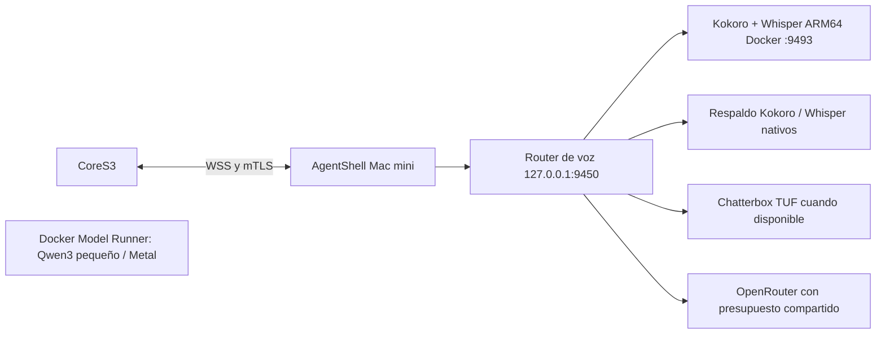

# Modelos locales de Sagwa en Docker Desktop

La Mac mini mantiene Muse como agente principal. El worker `sagwa-core-s3-voice` ejecuta Kokoro82M/ef_dora para voz española y Whisper base/int8 para transcripción. Publica exclusivamente `127.0.0.1:9493`; el CoreS3 accede a través del gateway autenticado existente, nunca directamente al puerto Docker. Conserva firmware0.2.0, OTA y sensores actuales.



El contenedor tiene límite2CPU,3GiB de RAM sin swap adicional,128procesos, raíz de solo lectura, usuario no root, sin capabilities y un tmpfs256MiB. `exec` en tmpfs es necesario: phonemizer crea una copia temporal de libespeak-ng para cargarla; se mantienen nosuid/nodev. No monta Docker socket, claves SSH, certificados del gateway ni claves de pago. Los pesos y configuración se montan de solo lectura. No descarga modelos al atender consultas (`HF_HUB_OFFLINE`). El token Docker es independiente del token de la voz existente.

Los modelos existentes se reutilizan desde `~/Library/Application Support/AgentShell/models`. Los secretos nuevos permanecen en `private/sagwa-docker` dentro de ese directorio de aplicación. Los registros HTTP no guardan texto ni PCM.

## Arranque reproducible

Desde la raíz del proyecto:

```sh
export PATH="/Applications/Docker.app/Contents/Resources/bin:$PATH"
python3 agentshell/scripts/prepare-mac-container.py
docker compose --env-file agentshell/.private/sagwa/docker-mac/compose.env \
  -f agentshell/voice/compose.mac.yml up -d --build
curl -fsS http://127.0.0.1:9493/health
```

`kokoro_warm` y `models_present` deben ser true antes de conectar el router. `restart: unless-stopped` aplica mientras Docker Desktop esté ejecutándose. Si Docker no arranca tras reiniciar macOS, el respaldo nativo permite seguir hablando; no se cambia la configuración de inicio de sesión del usuario.

La imagen base está fijada por digest y PyTorch se instala desde su índice oficial CPU, evitando descargar CUDA para esta Mac. Guardar `pip freeze` del contenedor y el digest de imagen en evidencia de despliegue. No alterar la imagen CUDA de TUF.

## Conexión al CoreS3 y reversión

El router nativo añade `container: {url: "http://127.0.0.1:9493/tts/stream", token_file: "<ruta privada>/token"}`. TUF recuperó su conexión durante las pruebas; se conserva Chatterbox como motor principal (`container_first: false`), Docker como primer respaldo local y Kokoro nativo después. `container_first: true` permite preferir Docker si se solicita. El único ledger de gasto continúa en Mac mini con límiteUS$5/mes.

`/tts/local-or-api` y `local_only` incluyen el worker Docker porque su endpoint es fijo y local; excluyen TUF y APIs cuando corresponde. Si el contenedor falla antes del primer PCM, el router continúa con los motores configurados. STT intenta el worker con plazo8s y conserva Whisper nativo como respaldo. Una voz ya empezada no cambia de motor a mitad de frase.

El servicio supervisado ejecuta `venv-sagwa/bin/python voice-sagwa/server.py`, después del launcher existente. La promoción modifica únicamente `voice-sagwa/server.py`, `voice-sagwa/tts_router.py` y `private/voice.json`; conserva el launcher y los entornos anteriores.

Tras obtener el dictamen independiente PASS para los hashes exactos:

```sh
python3 agentshell/scripts/connect-mac-container.py \
  --review agentshell/evidence/sagwa-v2/docker-mac-review-receipt.json
```

El script comprueba PCM autenticado del contenedor, respalda los tres archivos con SHA-256 y escribe de forma atómica. Para reiniciar valida UID y argv completos, espera que muera el proceso anterior y exige un nuevo PID con modelos listos y el orden de motores correcto. Si falla, restaura los archivos. El resultado entrega la ruta privada del backup.

```sh
python3 agentshell/scripts/connect-mac-container.py --rollback /ruta/del/backup
```

La reversión verifica los hashes y restaura los tres archivos. Puede recuperar un candidato que murió antes de abrir el puerto. Para retirar además el worker, detener solo `sagwa-core-s3-voice`. No requiere flashear el Core ni reiniciar TUF.

## Modelo de conversación local

Docker Model Runner tiene `ai/qwen3:4b-instruct-2507-q4_K_M` descargado. Se probaron tres conversaciones breves en español; es un modelo auxiliar, no una validación de calidad general ni un agente con herramientas. Muse conserva la orquestación. No se conecta automáticamente a tareas, cuentas, comandos o permisos. El primer candidato0.6B agotó respuestas en razonamiento sin texto y quedó descartado para la interfaz.

```sh
python3 agentshell/scripts/ask-sagwa-local.py --text 'Hola, Sagwa, ¿estás aquí?'
docker model ps
docker model unload ai/qwen3:4b-instruct-2507-q4_K_M
```

La API de Model Runner escucha solo en127.0.0.1:12434. En macOS, su motor llama.cpp/Metal corre en el host bajo Docker Model Runner; no se presenta como GPU dentro de un contenedor Linux. La voz de este contenedor usa CPU. Fuentes oficiales: [Model Runner](https://docs.docker.com/ai/model-runner/), [motores](https://docs.docker.com/ai/model-runner/inference-engines/), [PyTorch CPU](https://download.pytorch.org/whl/cpu/torch/), [Kokoro voces](https://huggingface.co/hexgrad/Kokoro-82M/blob/main/VOICES.md).

Las medidas y el estado realmente promovido se guardan en `evidence/sagwa-v2/mac-docker.json`; esta guía no sustituye ese registro. La prueba continua24h original sigue interrumpida por reinicio manual del Core y caída de telemetría TUF.
