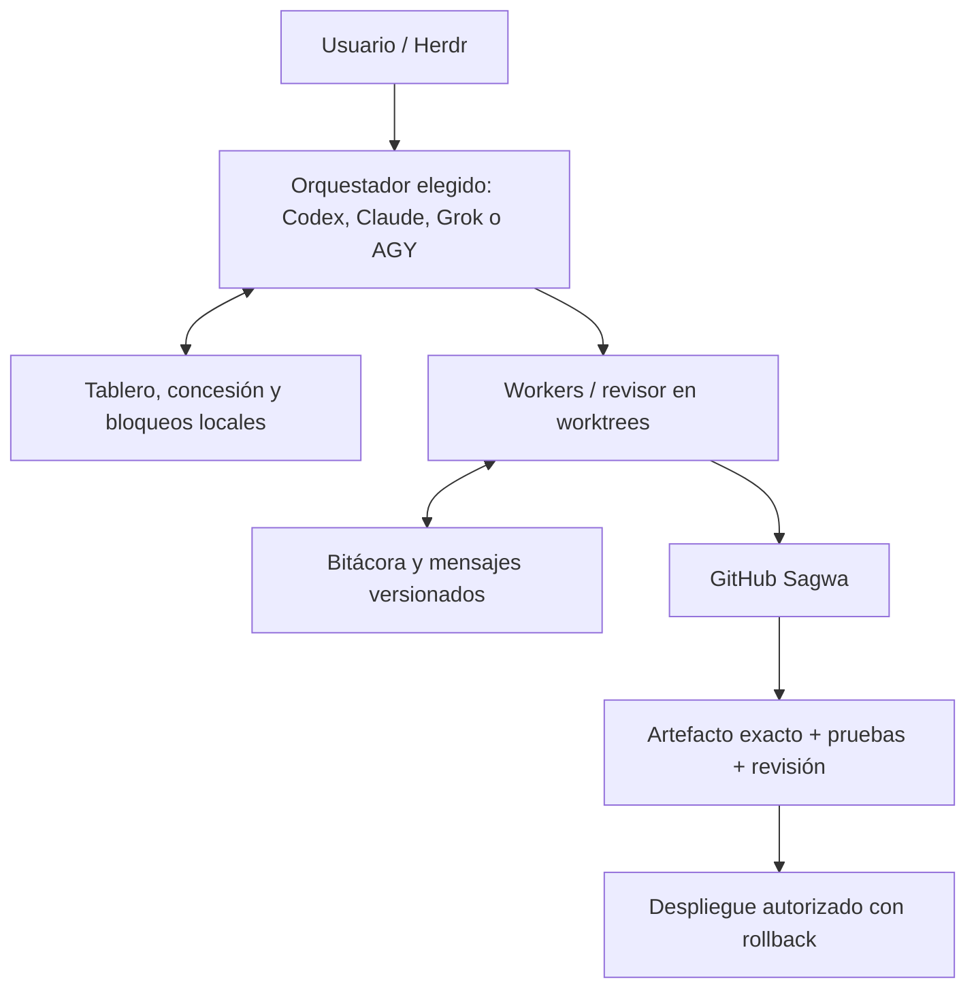
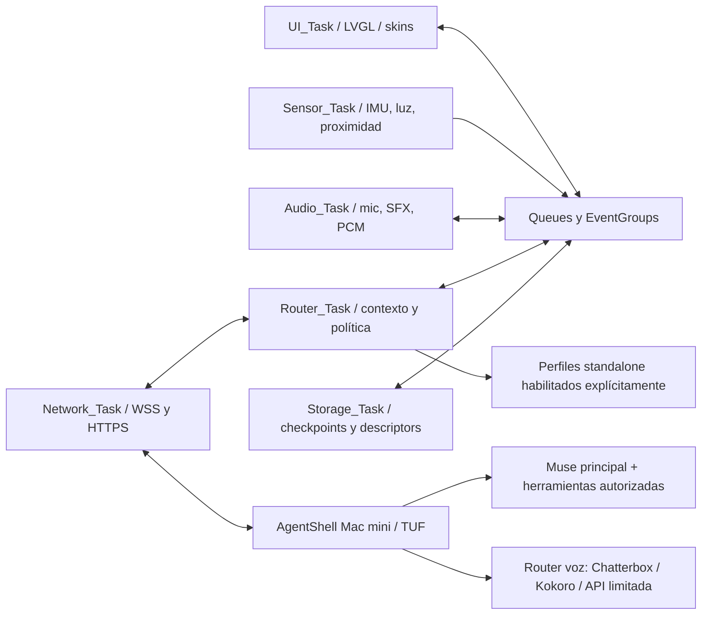

# Arquitectura del producto y del desarrollo

Hay dos sistemas de coordinación. AgentShell coordina peticiones y permisos del **producto**. `coord/` coordina agentes que **desarrollan** ese producto. Ninguna bitácora de desarrollo ejecuta comandos por sensores ni cambia autorizaciones de AgentShell.

Un único BSP posee SPI/I2C/I2S/cámara/touch. UI dibuja bajo mutex LVGL; sensores publican muestras, no llamadas remotas. Audio conserva generación del turno para cancelar; persistencia no bloquea UI. Dos buffers RGB565 PSRAM; finalización DMA es la referencia para FPS. [Detalle Edge](../agentshell/edge-firmware/ARCHITECTURE.md).

Adapters homelab reutilizan mTLS y disponibilidades auténticas; consultas privadas/herramientas siguen política de destinos. Proveedores standalone se habilitan solo con credenciales/contrato compatible y presupuesto propio. OAuth está preparado como contrato abstracto, sin refresh genérico implementado. El modelo WakeNet falta; la detección está desactivada hasta tener un artefacto verdadero y evaluado.

El firmware instalado es `agentshell/firmware`; la nueva arquitectura vive en `agentshell/edge-firmware`. La nueva tabla de datos no se instaló. Los diagnósticos app-only conservaron tabla antigua y no aceptan storage, vault o modelos del release futuro.
