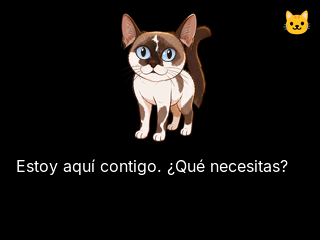

# Catálogo de interfaces

Estas33vistas son renders del compositor LVGL host del candidatoM, con datos sintéticos y reloj simulado. Sirven como referencia visual de pantallas/estados; **no son fotos del Core ni aceptación física**. N2 conserva el mismo diseño y cambió temporización. Galería local: [abrir index](previews/edge-m/index.html).

| Pantallas | Vistas |
|---|---|
| Navegación | [Menú](previews/edge-m/menu.png), [herramientas](previews/edge-m/tools.png), [configuración](previews/edge-m/settings.png) |
| Operación | [Agentes](previews/edge-m/agents.png), [destinos](previews/edge-m/destinations.png), [tareas](previews/edge-m/tasks.png), [routing](previews/edge-m/routing.png) |
| Lectura y extensiones | [Lectura](previews/edge-m/reading.png), [notas plugin](previews/edge-m/plugin-notes.png), [skins](previews/edge-m/skins.png) |
| Hardware | [Cámara preview](previews/edge-m/camera-preview.png), [sensores](previews/edge-m/sensors.png), [voz](previews/edge-m/voice.png), [mascota](previews/edge-m/pet-settings.png) |
| Confirmaciones | [Autorización](previews/edge-m/approval.png), [cancelación](previews/edge-m/cancel.png) |
| Enfoque | [Modo](previews/edge-m/mode-focus.png), [listo](previews/edge-m/focus-ready.png), [ejecución](previews/edge-m/focus-running.png), [pausa](previews/edge-m/focus-paused.png), [completado](previews/edge-m/focus-completed.png) |
| Skins | [Noche](previews/edge-m/mode-night.png), [telemetría](previews/edge-m/mode-telemetry.png), [centinela](previews/edge-m/mode-sentinel.png), [terminal](previews/edge-m/mode-terminal.png), [multimedia](previews/edge-m/mode-multimedia.png), [asistente](previews/edge-m/mode-assistant.png), [recuperación](previews/edge-m/mode-recovery.png) |
| Clima | [Sin datos](previews/edge-m/mode-weather.png), [forecast](previews/edge-m/mode-weather-current.png), [antiguo](previews/edge-m/mode-weather-stale.png) |
| Diagnóstico | [Historia local](previews/edge-m/local-history.png) |

El catálogo incluye la principal, todas las secundarias y variantes. Mascota doméstica corresponde a `home`; enfoque y clima tienen estados propios. Prioridad del emoji, micrófono/cámara visibles y confirmación de acciones siguen siendo requisitos. La selección de destino/proveedor debe reflejar disponibilidad real, no el texto sintético de estas capturas.
